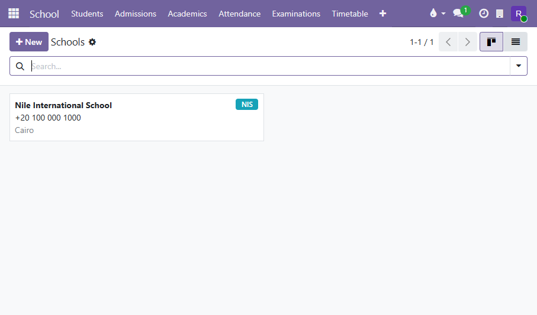
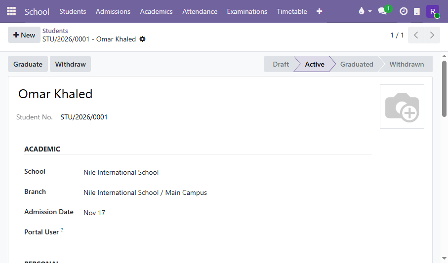
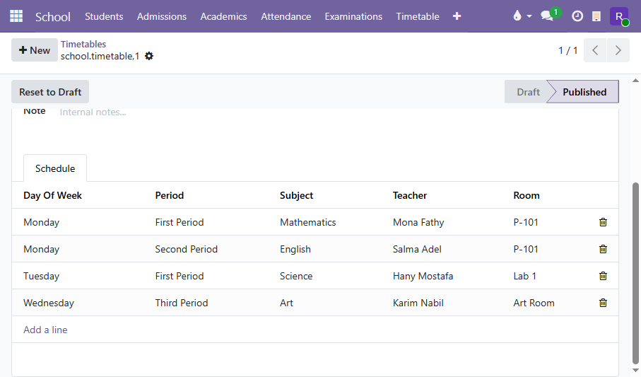
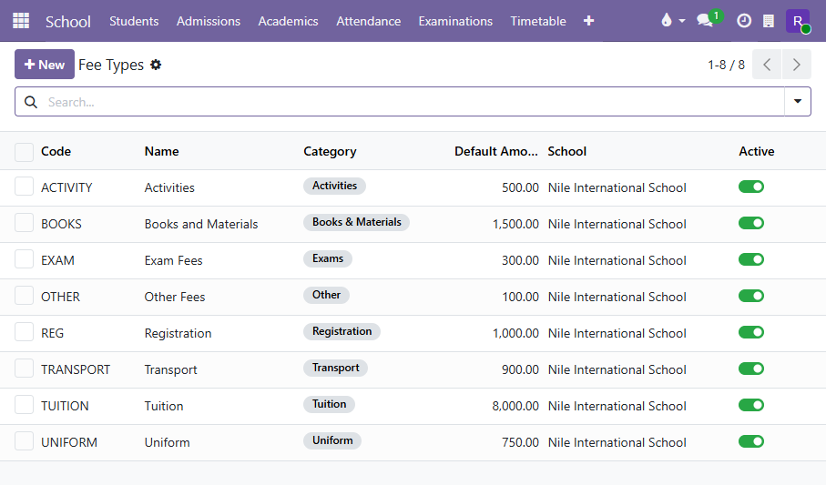
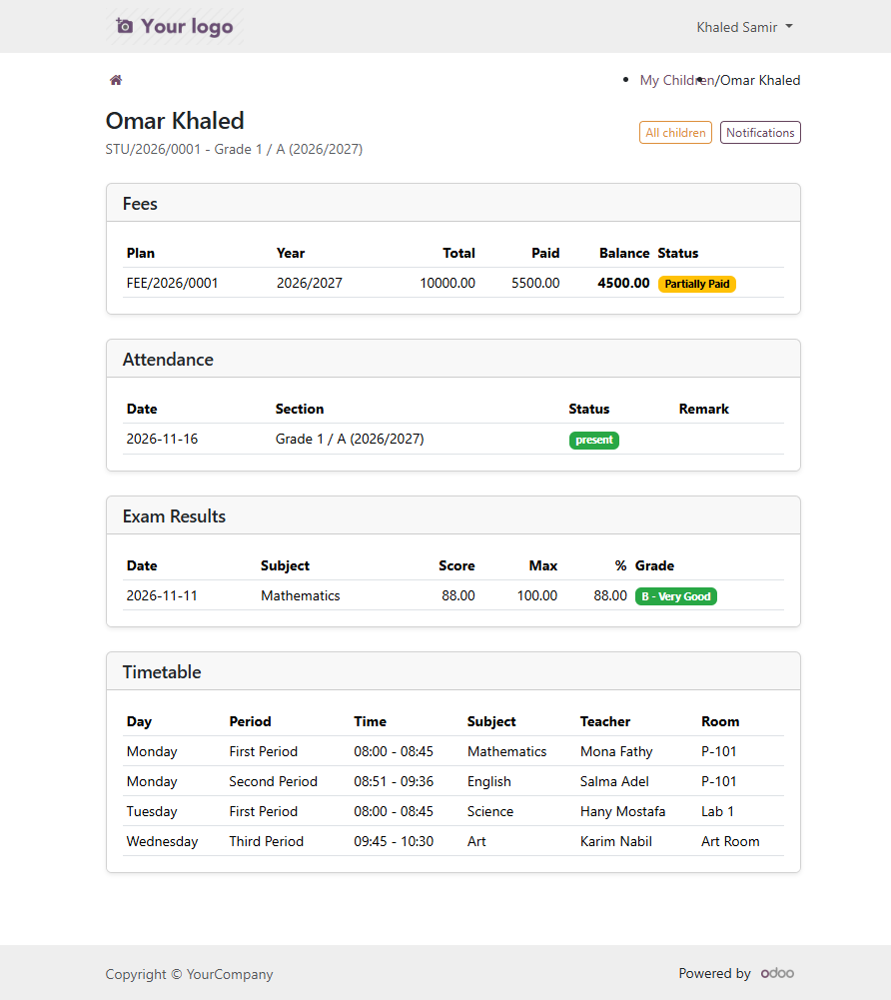
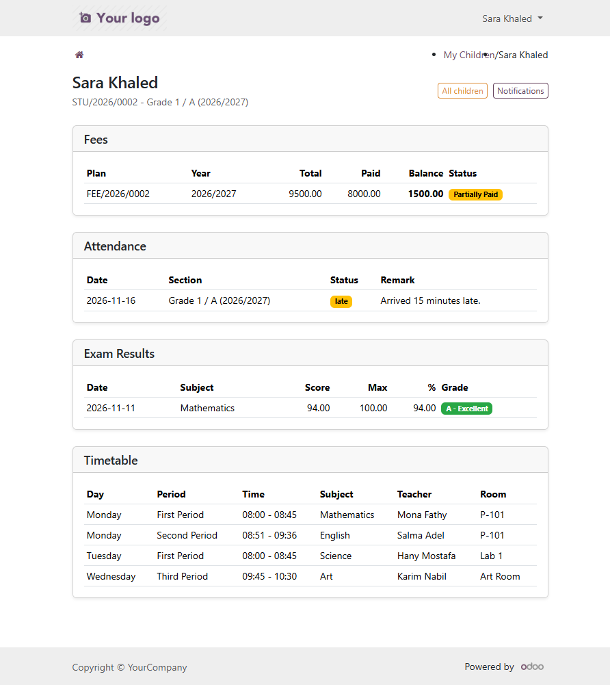

# School Management ERP — Odoo 19 Community

[](https://www.odoo.com/)
[](LICENSE)
[](https://www.python.org/)
[](docker-compose.yml)
[](#testing)

A modular school management system for **Odoo 19 Community**. It covers the
whole school cycle: schools and branches, academics, admissions, students,
teachers, timetables, attendance, exams, fees with an accounting bridge,
library, transport, communication — plus web portals for parents and students.

## Highlights

- **Multi-school, multi-branch** with per-user school/branch scoping and record rules.
- **Complete admissions flow**: applications → accepted → enrolled → enrollment records.
- **Academic setup**: years, curricula, stages, grades, subjects and sections.
- **Daily operations**: timetables, attendance sessions, exams, schedules and results.
- **Finance**: fee types, structures, student plans, payments and invoice bridging.
- **Extras**: library loans, transport routes/subscriptions, announcements and messages.
- **Portals**: parents follow fees, attendance, results and timetables; a dedicated progress tracker (backed by a JSON API) shows each child's level, averages, subject performance, exam trend and attention flags; students get their own dashboard.
- **Demo data and tests for every module**, verified on a live Odoo 19 + PostgreSQL stack.

## Table of contents

- [Screenshots](#screenshots)
- [Modules](#modules)
- [Requirements](#requirements)
- [Quick start](#quick-start)
- [Demo data and users](#demo-data-and-users)
- [Parent progress tracker & API](#parent-progress-tracker--api)
- [Configuration](#configuration)
- [Testing](#testing)
- [Automatic school codes](#automatic-school-codes)
- [Project structure](#project-structure)
- [Contributing](#contributing)
- [License](#license)

## Screenshots

All screens captured from the demo database — full gallery in
[docs/screenshots/demo](docs/screenshots/demo/README.md).

| | |
| :---: | :---: |
|  |  |
| Schools | Student file |
|  |  |
| Timetable schedule | Fee types |
|  |  |
| Parent portal — child dashboard | Student portal |

## Modules

| Module | Responsibility |
| --- | --- |
| `school_core` | Schools, branches, user school/branch scoping, shared mixins |
| `school_academic` | Academic years, curricula, stages, grades, subjects, sections |
| `school_security` | School groups and record rules (school isolation) |
| `school_student` | Student files, guardians and guardian links |
| `school_admission` | Admission applications with workflow states |
| `school_teacher` | Teacher profiles, contracts, subject assignment |
| `school_timetable` | Periods, timetables and schedule lines |
| `school_attendance` | Attendance sessions and lines |
| `school_exam` | Exams, exam schedules and results |
| `school_fees` | Fee types, structures, plans (assignments) and payments |
| `school_accounting` | Bridge school fees to Odoo invoices and payments |
| `school_library` | Books, members and loans |
| `school_transport` | Vehicles, routes, stops and subscriptions |
| `school_communication` | Announcements and school messages |
| `school_parent_portal` | Parent portal: `/my/children`, child dashboard, progress tracker API, notifications |
| `school_student_portal` | Student portal: `/my/student` and own progress tracker |

## Requirements

- Docker with Docker Compose (recommended), or
- Odoo 19 Community + PostgreSQL 16 installed manually.
- Python 3.12 (bundled in the Odoo 19 image).

Optional third-party accounting addons (Odoo Mates `om_account_accountant`
bundle, `web_responsive`) can be placed in `custom-addons/`, mounted at
`/mnt/custom-addons`. They are not part of this repository.

## Quick start

```bash
git clone https://github.com/abdomahmod876-bot/school-erp.git
cd school-erp
cp .env.example .env            # adjust POSTGRES_PASSWORD (file is git-ignored)
docker compose up -d --build

# first run: install the school modules with demo data
docker compose stop odoo
docker compose run --rm odoo -d school_erp \
  -i school_core,school_academic,school_security,school_student,school_admission,\
school_teacher,school_timetable,school_attendance,school_exam,school_fees,\
school_accounting,school_library,school_transport,school_communication,\
school_parent_portal,school_student_portal \
  --with-demo --stop-after-init
docker compose start odoo
```

Open <http://localhost:8069> (database `school_erp`). HTTPS through nginx is
available on <https://localhost> when certificates are present in
`docker/nginx/certs/` (ignored by git).

VS Code users can run the same steps from the ready-made tasks in
`.vscode/tasks.json` (`Odoo: init database`, `Odoo: update school modules`,
`Odoo: logs`, ...).

## Demo data and users

Demo data is loaded with `--with-demo`. All demo users use the password `demo`.

| Login | Role |
| --- | --- |
| `admin` | Administrator |
| `demo.manager` | School manager |
| `demo.staff` | School staff (read-only) |
| `demo.teacher` | Teacher |
| `demo.accountant` | Accountant |
| `demo.parent` | Parent portal |
| `demo.student` | Student portal |

The demo dataset contains one school with two branches, two academic years,
four sections, seven students with guardians and enrollments, eight admission
applications, four teachers, periods and published timetables, attendance
sessions, exams with results, fee types, plans and payments, library records,
transport routes and subscriptions, announcements and messages.

## Parent progress tracker & API

Guardians open **My Children → Progress** (or `/my/children/<student_id>/progress`)
to track a child's performance. Students reach the same page from their own
dashboard. The page is rendered from a JSON endpoint, so the data can also be
consumed by other clients.

Endpoint: `POST /school/parent/api/children/<student_id>/progress`
(JSON-RPC envelope, session authentication).

```bash
curl -s -X POST http://localhost:8069/school/parent/api/children/1/progress \
  -H 'Content-Type: application/json' \
  -b cookies.txt \
  -d '{"jsonrpc":"2.0","method":"call","params":{}}'
```

Response fields:

| Field | Content |
| --- | --- |
| `student` | Name, student number, state, school |
| `level` | Stage, grade, section and academic year |
| `attendance` | Sessions, present/absent/late/excused counts and attendance rate |
| `academics` | Weighted average, performance level, per-subject averages, exam trend and attention flags |
| `fees` | Confirmed totals, paid amount, balance and payment state |

Performance levels: 90+ **Excellent**, 80+ **Very Good**, 70+ **Good**,
60+ **Acceptable**, below 60 **Needs Support**. Attention flags are added when
the average is below the pass mark, attendance is under 75%, or an exam result
is failed.

Access is limited to the guardian's own children (or the student's own file);
other student ids return a JSON-RPC `NotFound` error.

## Configuration

Database name and credentials are read from `.env`, which is excluded from
version control:

```dotenv
POSTGRES_DB=postgres
POSTGRES_USER=odoo
POSTGRES_PASSWORD=change-me
```

`docker-compose.yml` interpolates these variables for both the `db` and `odoo`
containers (including the `pg_isready` healthcheck) and falls back to the
values above when `.env` is missing.

## Testing

```bash
MSYS_NO_PATHCONV=1 docker compose run --rm odoo -d school_erp \
  --test-tags /school_core --stop-after-init
```

Replace `/school_core` with any module to run its tests. On Linux/macOS drop
the `MSYS_NO_PATHCONV=1` prefix (it only prevents Git Bash from rewriting the
test tag path).

`tools/validate_addons.py` performs a fast static check of manifests, XML ids,
translation files and file references before running the modules:

```bash
python tools/validate_addons.py
```

## Automatic school codes

The school `code` is generated from the school name when left empty:

- multi-word names use the first letter of each word (`Cairo Modern School` → `CMS`),
- single words use their first four letters (`Alphabet` → `ALPH`),
- names without letters fall back to `SCH`,
- uniqueness is enforced per company with a numeric suffix (`GVS` → `GVS2`),
- manual codes are preserved, and clearing a code regenerates it.

## Project structure

```
addons/            project modules (16)
custom-addons/     optional third-party accounting addons (ignored by git)
docker/            Odoo config, nginx config, entrypoint scripts
docs/screenshots/  module and portal screenshots (demo data)
tools/             addon validation helper
.vscode/tasks.json ready-made compose tasks
```

## Contributing

Issues and pull requests are welcome. Please keep the existing module layout
(`addons/<module>`), add translations and demo records with any new model, and
run the module tests plus `tools/validate_addons.py` before opening a PR.

## License

This project is distributed under the **GNU Lesser General Public License
v3.0** (LGPL-3) — see [LICENSE](LICENSE). Every module manifest declares
`license: LGPL-3`.
